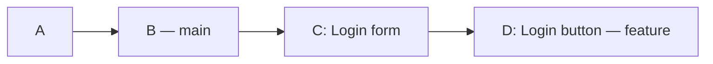
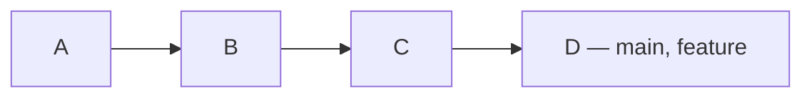
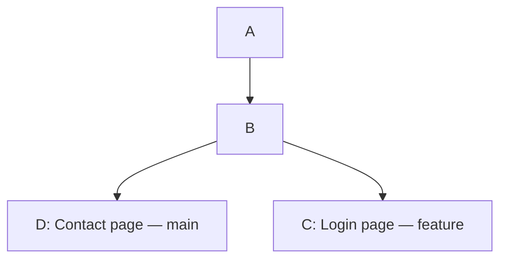
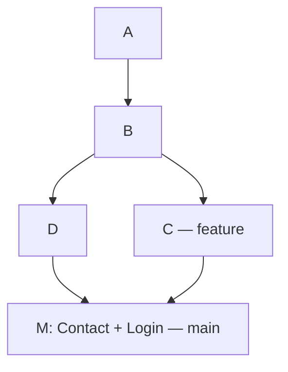
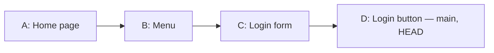
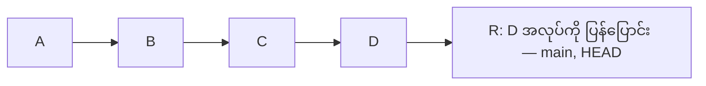
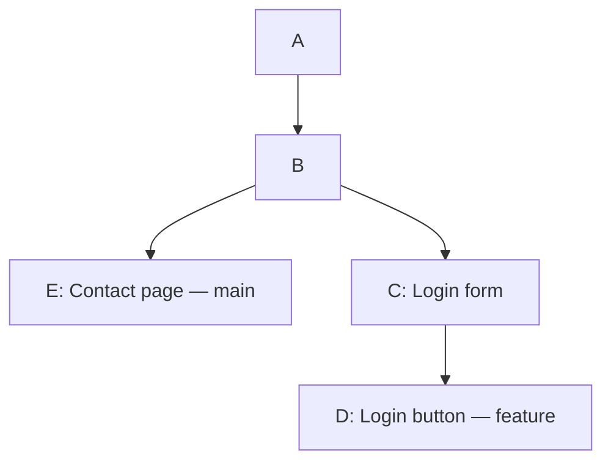
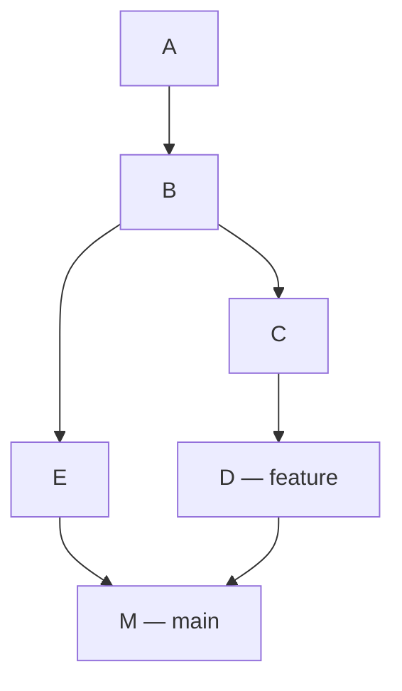
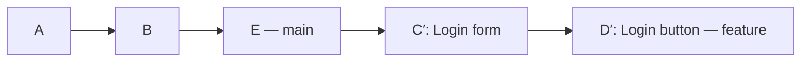
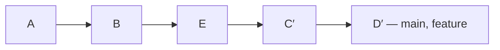

# Git_HomeWork

## Git Branching Cheat Sheet

Branch ဆိုတာ အလုပ်အသစ်တစ်ခုကို သီးခြားခွဲလုပ်ဖို့
သုံးတာပါ။


| လုပ်ချင်တာ | Command |
|---|---|
| Local branch တွေကြည့်မယ် | `git branch` |
| လက်ရှိ branch နဲ့ ဖိုင်အခြေအနေစစ်မယ် | `git status` |
| Branch အသစ်လုပ်မယ် | `git branch feature` |
| ရှိပြီးသား branch ကို ပြောင်းမယ် | `git switch feature` |
| အသစ်လုပ်ပြီး ပြောင်းမယ် | `git switch -c feature` |
| main ကို ပြန်ပြောင်းမယ် | `git switch main` |
| လက်ရှိ branch နာမည်ပြောင်းမယ် | `git branch -m login` |
| အလုပ်ပြီးတဲ့ branch ဖျက်မယ် | `git branch -d feature` |
| ရွှေ့ခဲ့တဲ့ commit တွေ ပြန်ရှာမယ် | `git reflog` |

ဖျက်မယ့် branch ပေါ်မှာ ရှိနေရင် ဖျက်လို့မရဘူး။
main branch ကို အရင်ပြောင်းရတယ်။


### Checkout နဲ့ Switch

| Switch command | Checkout command |
|---|---|
| `git switch feature` | `git checkout feature` |
| `git switch -c feature` | `git checkout -b feature` |


## 2. Different types of Merge strategies

1. Fast-forward Merge
2. Non-fast-forward Merge
3. Squash Merge

### 2.1 Fast-forward Merge

main ကနေ feature branch ခွဲပြီးနောက် feature မှာပဲ
commit အသစ်တွေ လုပ်ထားတယ်။ main မှာ commit အသစ် မရှိဘူး။

#### ဥပမာ

main မှာ A နဲ့ B commit ရှိတယ်။
B ကနေ feature ခွဲပြီး အလုပ်နှစ်ခု လုပ်ထားတယ်။

- C = Login form ထည့်တယ်။
- D = Login button ထည့်တယ်။

#### Merge မလုပ်ခင်



- main ရဲ့ history က A → B ဖြစ်တယ်။
- feature ရဲ့ history က A → B → C → D ဖြစ်တယ်။

#### အသုံးပြုရတဲ့ Command

```bash
git switch main
git merge --ff-only feature
```

1. `git switch main` က main branch ကို ပြောင်းတယ်။
2. `git merge --ff-only feature` က main ကို
   feature ရဲ့ နောက်ဆုံး commit D ဆီ ရွှေ့ပေးတယ်။

#### Merge လုပ်ပြီး



အခုဆိုရင် main နဲ့ feature နှစ်ခုလုံးက D ကို ညွှန်းနေတယ်။
main ထဲမှာ Login form နဲ့ Login button ရော ပါလာပြီ။

**Commit အသစ် မလုပ်ဘဲ main ကို B ကနေ D ဆီ
ရွှေ့ပေးတာကို Fast-forward merge လို့ ခေါ်တယ်။**

`--ff-only` က fast-forward လုပ်လို့ရမှ ပေါင်းပေးတယ်။
branch နှစ်ခုလုံးမှာ သီးခြား commit အသစ်ရှိနေရင်
merge မလုပ်ဘဲ ရပ်သွားပါမယ်။


### 2.2 Non-fast-forward Merge

main branch ကနေ feature branch ခွဲပြီးနောက် main branch
နဲ့ feature branch နှစ်ခုလုံးမှာ
သီးခြား commit အသစ်တွေ လုပ်ထားတယ်။

#### ဥပမာ

main branch မှာ A နဲ့ B commit ရှိတယ်။
B ကနေ feature branch ခွဲထားတယ်။

- feature branch မှာ C = Login page ထပ်ထည့်
- main branch မှာ D = Contact page ထပ်ထည့်

#### Merge မလုပ်ခင်



- main ရဲ့ history က A → B → D ဖြစ်တယ်။
- feature ရဲ့ history က A → B → C ဖြစ်တယ်။

ဒီဥပမာမှာ နှစ်ဘက်လုံးမှာ အလုပ်အသစ်ရှိလို့ main ကို C ဆီ
ရွှေ့ပေးရုံနဲ့ မရတော့ဘူး။ C နဲ့ D ရဲ့အလုပ်တွေကို
ပေါင်းဖို့ လိုတယ်။

#### အသုံးပြုမယ့် Command

```bash
git switch main
git merge feature
```

1. `git switch main` က main branch ကို ပြောင်းတယ်။
2. `git merge feature` က feature ရဲ့ Login အလုပ်နဲ့
   main ရဲ့ Contact အလုပ်ကို ပေါင်းပေးတယ်။

#### Merge လုပ်ပြီး



M ဆိုတဲ့ merge commit အသစ် ရလာတယ်။
M က C နဲ့ D ကို ချိတ်ထားပြီး နှစ်ဘက်လုံးရဲ့အလုပ် ပါတယ်။

- main က M ကို ညွှန်းနေတယ်။
- feature က C ကို ညွှန်းနေဆဲ။
- မူရင်း C နဲ့ D commit တွေ ဆက်ရှိနေတယ်။

**Branch နှစ်ခုရဲ့အလုပ်ကို merge commit အသစ်နဲ့
ပေါင်းချိတ်တာကို Non-fast-forward merge လို့ ခေါ်တယ်။**

#### --no-ff ဆိုတာ

Fast-forward လုပ်လို့ရတဲ့အခြေအနေမှာတောင်
merge commit သီးသန့် ထားချင်ရင် `--no-ff` သုံးတယ်။

```bash
git switch main
git merge --no-ff feature
```

### 2.3 Squash Merge

Squash merge ဆိုတာ feature branch က အပြောင်းအလဲတွေကို
main ထဲမှာ commit တစ်ခုတည်းအဖြစ် စုပြီး သိမ်းတာပါ။

#### ဥပမာ

main မှာ A နဲ့ B commit ရှိတယ်။
B ကနေ feature branch ခွဲပြီး အောက်ပါအလုပ်တွေ လုပ်ထား

| Commit | လုပ်ထားတဲ့အလုပ် |
|---|---|
| C | Login form ရေးတယ် |
| D | Login button ထည့်တယ် |
| E | Login အရောင်ပြင်တယ် |

Merge မလုပ်ခင် history က—

- main: A → B
- feature: A → B → C → D → E

#### အသုံးပြုမယ့် Command

```bash
git switch main
git merge --squash feature
git commit -m "Add complete login page"
```

1. `git switch main` က main branch ကို ပြောင်း
2. `git merge --squash feature` က feature ရဲ့ အပြောင်းအလဲတွေကို
   main ရဲ့ working files နဲ့ staging area ထဲ ထည့်ပေး
   Commit အသစ် မလုပ်ရသေး
3. `git commit` က အလုပ်အားလုံးကို S ဆိုတဲ့ commit
   တစ်ခုအဖြစ် သိမ်း

#### လုပ်ပြီးနောက်

- main: A → B → S
- feature: A → B → C → D → E

S ထဲမှာ Login form၊ Login button နဲ့ အရောင်ပြင်ထားမှု
အားလုံး ပါတယ်။ main history ထဲမှာတော့ C၊ D၊ E
တစ်ခုချင်းမပါဘဲ S တစ်ခုပဲ တိုးလာ

Feature branch မှာ မူရင်း C၊ D၊ E commit တွေ ဆက်ရှိ 


## 3. Git Time Traveling Cheat Sheet

Git မှာ commit လုပ်ထားတဲ့ အခြေအနေအဟောင်းတွေကို
ပြန်ကြည့်နိုင် 
မှားထားတဲ့အလုပ်ကိုလည်း ပြန်ပြင်နိုင်


### Example Commit History



main က D ကို ညွှန်းနေ
main ပေါ်မှာ ရှိနေလို့ HEAD လည်း D မှာ ရှိတယ်။

- `HEAD` = အခု ကိုယ်ရောက်နေတဲ့ commit ကို ရည်ညွှန်းတယ်။ ဒီဥပမာမှာ D ပါ။
- `HEAD~1` = ဒီဥပမာမှာ C
- `HEAD~2` = ဒီဥပမာမှာ B

| လုပ်ချင်တာ | Command |
|---|---|
| Commit history ကြည့်မယ် | `git log --oneline` |
| Commit တစ်ခုရဲ့ အပြောင်းအလဲကြည့်မယ် | `git show <commit-id>` |
| အဟောင်းကို ကြည့်ရုံကြည့်မယ် | `git switch --detach <commit-id>` |
| main ကို ပြန်လာမယ် | `git switch main` |


### 1. Revert — အပြောင်းအလဲကို ပြန်ပြောင်းတဲ့ Commit အသစ် ထည့်မယ်

လက်ရှိ history က A → B → C → D ဖြစ်တယ်။
အခု D မှာ ထည့်ထားတဲ့ Login button ကို
ပြန်ဖယ်ချင်တယ်။

D ပေါ်မှာ ရှိနေတဲ့အချိန် revert ကို သုံးမယ်—

```bash
git revert HEAD
```

ဒီအခြေအနေမှာ HEAD က လက်ရှိရောက်နေတဲ့ D commit ကို ရည်ညွှန်းတာပါ။



Git က D ကို မဖျက်ဘဲ D ရဲ့အပြောင်းအလဲကို
ပြန်ပြောင်းတဲ့ R commit အသစ် ထည့်ပေးတယ်။

- Login button ထည့်ထားတာ ပြန်ဖယ်သွား
- D commit လည်း ဆက်ရှိ
- ပြန်ပြင်ထားတဲ့ R commit လည်း ရှိ


### 4. Reset — Branch ကို အဟောင်းဆီ ပြန်ရွှေ့မယ်

မူလ A → B → C → D အခြေအနေကနေ စ


#### Soft Reset

```bash
git reset --soft HEAD~1
```

main က C ကို ပြန်ရောက်

D မှာရေးထားတဲ့ Login button code က ဖိုင်ထဲမှာ ကျန်
D ရဲ့ အပြောင်းအလဲတွေလည်း staging area ထဲမှာ ရှိနေ

 `--soft` က လက်ရှိ working files နဲ့
staging area ကို မပြောင်းဘဲ branch ကိုပဲ ပြန်ရွှေ့တာပါ။

`git add` ထပ်မလိုဘဲ ပြန် commit လုပ်နိုင်တယ်။

```bash
git commit -m "Add login button"
```


#### Mixed Reset

```bash
git reset --mixed HEAD~1
```

- main က C ကို ပြန်ရောက်
- Login button code က ဖိုင်ထဲမှာ ကျန်
- Button အပြောင်းအလဲက stage ထဲ မရှိတော့
- ပြန် add လုပ်ပြီးမှ commit လုပ်ရမယ်။

```bash
git add login.html
git commit -m "Add login button"
```

#### Hard Reset

```bash
git reset --hard HEAD~1
```

main က C ကို ပြန်ရောက်ပြီး tracked files တွေကိုပါ
C တုန်းကအတိုင်း ပြန်ထား

ဒီဥပမာမှာ Login button code ပြန်ပျောက်သွား


## 4. Rebase vs Merge Cheat Sheet

Merge နဲ့ Rebase နှစ်ခုလုံးက branch တွေရဲ့အလုပ်တွေကို
ပေါင်းစပ်ဖို့ သုံးတယ်။ Commit history ထားပုံ ကွာတယ်။

### စတင်အခြေအနေ

A နဲ့ B commit ရှိတဲ့ main ကနေ feature ခွဲထား

- feature မှာ C = Login form ရေး
- feature မှာ D = Login button ထည့်
- main မှာ E = Contact page ထည့်



| Branch | Commit history |
|---|---|
| main | A → B → E |
| feature | A → B → C → D |

### 1. Merge

Feature ရဲ့ Login အလုပ်တွေကို main ထဲ ပေါင်းမယ်။

```bash
git switch main
git merge feature
```


#### လုပ်ပြီးနောက်



- E နဲ့ D ကို ချိတ်တဲ့ M merge commit အသစ် ရ
- မူရင်း C၊ D၊ E commit တွေ မပြောင်းဘူး။
- main က M ကို ညွှန်း
- feature က D ကို ညွှန်းနေဆဲ။
- main မှာ Contact page နဲ့ Login အလုပ်တွေ ပါလာ


### 2. Rebase

ကိုယ့် feature အလုပ်တွေကို main ရဲ့ နောက်ဆုံးအလုပ်
E အပေါ်မှာ ပြန်တင်မယ်။

```bash
git switch feature
git rebase main
```

#### လုပ်ပြီးနောက်



Git က—

1. main ရဲ့ E ကို base အသစ်အဖြစ် ယူ
2. C ရဲ့ Login form အပြောင်းအလဲကို E အပေါ်
   ပြန်တင်ပြီး C′ commit လုပ်
3. D ရဲ့ Login button အပြောင်းအလဲကို C′ အပေါ်
   ပြန်တင်ပြီး D′ commit လုပ်

C′ နဲ့ D′ က commit အသစ်တွေဖြစ်လို့
မူရင်း C၊ D နဲ့ commit ID မတူတော့ဘူး။

| Branch | Rebase မလုပ်ခင် | Rebase လုပ်ပြီး |
|---|---|---|
| main | A → B → E | A → B → E |
| feature | A → B → C → D | A → B → E → C′ → D′ |

**Rebase က ကိုယ့် commit တွေကို base အသစ်အပေါ်
ပြန်တင်တာပါ။ ဒီအချိန်မှာ main က E မှာပဲ ရှိသေးတယ်။**

### Rebase ပြီး main ထဲ ထည့်မယ်

main မှာ commit အသစ် ထပ်မလုပ်ထားဘူးဆိုရင်—

```bash
git switch main
git merge --ff-only feature
```



အခု main က D′ ဆီ ရောက်သွားပြီး
Contact page နဲ့ Login အလုပ်တွေ ပါလာ
