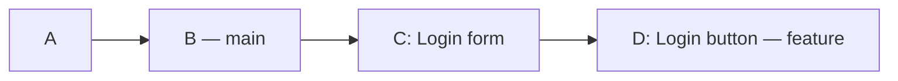
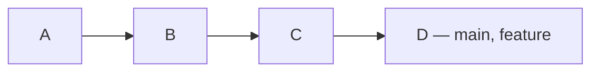

# Git_HomeWork

## Git Branching Cheat Sheet

Branch ဆိုတာ အလုပ်အသစ်တစ်ခုကို သီးခြားခွဲလုပ်ဖို့
သုံးတာပါ။


| လုပ်ချင်တာ | Command |
|---|---|
| Local branch တွေကြည့်မယ် | `git branch` |
| လက်ရှိ branch နဲ့ ဖိုင်အခြေအနေစစ်မယ် | `git status` |
| Branch အသစ်လုပ်မယ် | `git branch feature` |
| ရှိပြီးသား branch ကို ပြောင်းမယ် | `git switch feature` |
| အသစ်လုပ်ပြီး ပြောင်းမယ် | `git switch -c feature` |
| main ကို ပြန်ပြောင်းမယ် | `git switch main` |
| လက်ရှိ branch နာမည်ပြောင်းမယ် | `git branch -m login` |
| အလုပ်ပြီးတဲ့ branch ဖျက်မယ် | `git branch -d feature` |

ဖျက်မယ့် branch ပေါ်မှာ ရှိနေရင် ဖျက်လို့မရဘူး။
main branch ကို အရင်ပြောင်းရတယ်။


### Checkout နဲ့ Switch

| Switch command | Checkout command |
|---|---|
| `git switch feature` | `git checkout feature` |
| `git switch -c feature` | `git checkout -b feature` |


## 2. Different types of Merge strategies

1. Fast-forward Merge
2. Non-fast-forward Merge
3. Squash Merge

### 2.1 Fast-forward Merge

main ကနေ feature branch ခွဲပြီးနောက် feature မှာပဲ
commit အသစ်တွေ လုပ်ထားတယ်။ main မှာ commit အသစ် မရှိဘူး။

#### ဥပမာ

main မှာ A နဲ့ B commit ရှိတယ်။
B ကနေ feature ခွဲပြီး အလုပ်နှစ်ခု လုပ်ထားတယ်။

- C = Login form ထည့်တယ်။
- D = Login button ထည့်တယ်။

#### Merge မလုပ်ခင်



- main ရဲ့ history က A → B ဖြစ်တယ်။
- feature ရဲ့ history က A → B → C → D ဖြစ်တယ်။

#### အသုံးပြုရတဲ့ Command

```bash
git switch main
git merge --ff-only feature
```

1. `git switch main` က main branch ကို ပြောင်းတယ်။
2. `git merge --ff-only feature` က main ကို
   feature ရဲ့ နောက်ဆုံး commit D ဆီ ရွှေ့ပေးတယ်။

#### Merge လုပ်ပြီး



အခုဆိုရင် main နဲ့ feature နှစ်ခုလုံးက D ကို ညွှန်းနေတယ်။
main ထဲမှာ Login form နဲ့ Login button ရော ပါလာပြီ။

**Commit အသစ် မလုပ်ဘဲ main ကို B ကနေ D ဆီ
ရွှေ့ပေးတာကို Fast-forward merge လို့ ခေါ်တယ်။**

`--ff-only` က fast-forward လုပ်လို့ရမှ ပေါင်းပေးတယ်။
branch နှစ်ခုလုံးမှာ သီးခြား commit အသစ်ရှိနေရင်
merge မလုပ်ဘဲ ရပ်သွားပါမယ်။


